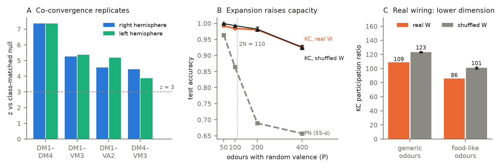

# From neurons to connectome analysis: a hands-on FlyWire project

A beginner-friendly, notebook-based course that goes from "what is a neuron?" to a real, small research analysis on the **FlyWire whole-brain connectome** of *Drosophila*.

The research question running through the course:

> In the fly mushroom body, is the wiring from projection neurons (PNs) to Kenyon cells (KCs) **random or structured**? And if it is structured, what does that structure do for odour coding and learning?

By the end you will have reproduced a known result (structured co-convergence of food-related glomeruli onto KCs), checked that it is robust, built a toy model of expansion coding and associative learning, and written the result up as a one-page research note.

No neuroscience background is assumed. Basic Python helps; Lesson 0 covers the pandas you need.



## Course map

| # | Notebook | Topic | You will learn | TODOs |
|---|---|---|---|---|
| 0 | [`00_pandas_basics`](notebooks/00_pandas_basics.ipynb) | pandas crash course | DataFrame/Series, selecting, boolean masks, `groupby`, `merge` | 10 |
| 1 | [`01_neurotransmitters`](notebooks/01_neurotransmitters.ipynb) | Neurons and synapses | excitation vs inhibition; a "data trap" in machine-learning annotations | 3 |
| 2 | [`02_olfactory_circuit`](notebooks/02_olfactory_circuit.ipynb) | The fly olfactory circuit | ORN → glomerulus → PN → KC → MBON; APL inhibition; dopamine and learning | 5 |
| 3 | [`03_connectome_data`](notebooks/03_connectome_data.ipynb) | What a connectome is | EM reconstruction, root IDs, synapse thresholds, edge lists vs adjacency matrices | 5 |
| 4 | [`04_null_models`](notebooks/04_null_models.ipynb) | Null models and permutation tests | p-values, z-scores, degree-preserving randomisation, implementing **curveball** | 6 |
| 5 | [`05_structure_and_function`](notebooks/05_structure_and_function.ipynb) | Back to the research question | replication, sensitivity analysis, **Cover's theorem**, MBON readout, participation ratio | 8 |
| 6 | [`06_writing_it_up`](notebooks/06_writing_it_up.ipynb) | Writing and communication | effect sizes, hedging, caveats, a one-page note, answering questions | 10 |

Each lesson takes about 1–2 hours. Every notebook follows the same pattern: **explanation (markdown) → worked example (provided code) → TODO (an empty code cell for you)**, with one TODO per cell, and ends with self-test questions.

**Fastest route** if you already know Python and some neuroscience: Lessons 3 → 4 → 5 → 6.

## Exercises and solutions

- [`notebooks/`](notebooks/) holds the **exercise** versions: TODO cells are empty (or have `___` blanks to fill in).
- [`solutions/`](solutions/) holds the **worked solutions**, executed, with outputs and model answers to the self-test questions.

Try each TODO yourself before looking. Both versions are generated from the same source files in [`tools/lessons/`](tools/lessons/); if you want to change a lesson, edit the source and run `python tools/build.py`.

## Setup

```bash
git clone https://github.com/Chen-xi111/flywire-mushroom-body-course.git
cd flywire-mushroom-body-course
pip install -r requirements.txt
python scripts/download_data.py
```

Then open `notebooks/00_pandas_basics.ipynb` (or whichever lesson you start with) in Jupyter or VS Code and run the cells from top to bottom with **Shift + Enter**.

## Data

All data are from FlyWire release **v783** and are licensed **CC BY 4.0**.

| File | Size | Where it comes from |
|---|---|---|
| `data/pn_kc_edges_all.parquet` | 130 KB | **included**: every uniglomerular-PN → KC edge, extracted from the full connection table |
| `data/neuron_annotations.tsv` | 32 MB | downloaded by `scripts/download_data.py` from [flyconnectome/flywire_annotations](https://github.com/flyconnectome/flywire_annotations) (checksum verified) |
| `data/proofread_connections_783.feather` | 850 MB | optional, `scripts/download_data.py --full`, from [Zenodo 10676866](https://zenodo.org/records/10676866); only used in Lesson 3 Step 0 and to rebuild the edge file |

## Background reading

Optional, and in rough order of use:

- **Neuromatch Academy, Computational Neuroscience**: free online course with Python exercises, a good companion.
- Dayan & Abbott, *Theoretical Neuroscience*: the standard textbook.
- Modi, Shuai & Turner (2020), *The Drosophila mushroom body: from architecture to algorithm in a learning circuit*, Annual Review of Neuroscience. Read before Lesson 2.
- Caron et al. (2013), *Random convergence of olfactory inputs in the Drosophila mushroom body*, Nature.
- Zheng et al. (2022), *Structured sampling of olfactory input by the fly mushroom body*, Current Biology.
- Litwin-Kumar et al. (2017), *Optimal degrees of synaptic connectivity*, Neuron.
- Cover (1965), *Geometrical and statistical properties of systems of linear inequalities with applications in pattern recognition*.

## A note on what this course claims

The course **reproduces and explores**; it does not claim new findings. The structured co-convergence it finds is consistent with previously reported structure in PN→KC wiring (Zheng et al. 2022), and the modelling results hold only for the toy model used here. Lesson 6 is largely about saying exactly that, and no more.

## Credits and citation

If you use the data, please cite the FlyWire papers:

- Dorkenwald, S. et al. (2024). Neuronal wiring diagram of an adult brain. *Nature* 634, 124–138.
- Schlegel, P. et al. (2024). Whole-brain annotation and multi-connectome cell typing of *Drosophila*. *Nature* 634, 139–152.

FlyWire data are provided by the FlyWire Consortium under CC BY 4.0.

## License

- Code: [MIT](LICENSE).
- Lesson text: [CC BY 4.0](https://creativecommons.org/licenses/by/4.0/).
- Data: CC BY 4.0, from the FlyWire Consortium (see above).
